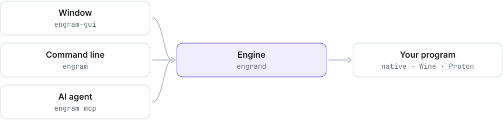

<div align="center">


# Engram

Memory scanner for Linux, Wine and AI agents.

[](https://github.com/Trendorin/engram/releases/latest)
[](LICENSE)


[Download](https://github.com/Trendorin/engram/releases/latest) · [Install](#install) · [Wiki](docs/wiki/en/README.md) · [Changelog](CHANGELOG.md) · [Русский](README.ru.md)

</div>


Engram works like Cheat Engine or PINCE. Find the number of arrows, gold or health in a running
program, change it, freeze it, find the code that writes it and save a pointer path that
survives restarts. It works with native Linux programs and with Windows games under Wine and
Proton.

AI coding agents (OpenCode, Claude Code, Codex, Gemini CLI) can drive it too. Open a terminal
next to the window and ask *"find how many arrows I have and double it"*: the agent works in the
same session you see, asks you to change the value in the game, narrows the scan and saves the
address to your table. It cannot change memory until you click **Allow**.

## Features

- Value scans: exact, unknown, greater, less, between, changed, unchanged, increased, decreased.
  `auto` checks i32, i64, f32 and f64 in one pass and ranks what it finds.
- Byte patterns with `??` wildcards, UTF-8 and UTF-16 text, one step of undo.
- An address table per game, with freezing and expressions like `Game.exe+1A2B30` or
  `[[Game.exe+10]+18]+40`.
- Pointer scan with verified, module-based paths.
- Hardware watchpoints: what writes to or reads an address.
- Wine and Proton games show up as `Game.exe`; PE modules and 32-bit games are handled.
- An MCP server and a command line for agents; every change to the target waits for you.
- A native window (Slint with your Qt style), light and dark.

## Install

| your system | file from the [latest release](https://github.com/Trendorin/engram/releases/latest) |
|---|---|
| Arch Linux, CachyOS, Manjaro | `engram-1.1.3-1-x86_64.pkg.tar.zst` |
| Debian 13 and newer | `engram_1.1.3-1_amd64.deb` |
| Fedora 44 and newer | `engram-1.1.3-1.fc44.x86_64.rpm` |
| any distribution with glibc 2.35+ | `Engram-1.1.3-x86_64.AppImage` |

```sh
sudo pacman -U ./engram-1.1.3-1-x86_64.pkg.tar.zst    # Arch
sudo apt install ./engram_1.1.3-1_amd64.deb            # Debian
sudo dnf install ./engram-1.1.3-1.fc44.x86_64.rpm      # Fedora
chmod +x Engram-1.1.3-x86_64.AppImage && ./Engram-1.1.3-x86_64.AppImage
```

Every package is built in a clean container of its distribution, then installed and started
there before it is published. Check the files with `sha256sum --ignore-missing -c SHA256SUMS`.
With arguments the AppImage is the `engram` command line (`./Engram-*.AppImage doctor`).

### From source

`install.sh` checks for Rust 1.88+, a C/C++ compiler and the libraries the window needs, and
offers to install whatever is missing with pacman, apt, dnf or zypper. Where the distribution's
Rust is older (Debian, Ubuntu) it offers rustup, into `~/.cargo` and without `sudo`.

```sh
git clone https://github.com/Trendorin/engram && cd engram
./install.sh                 # asks a few questions, builds, installs into ~/.local
./install.sh --uninstall     # removes exactly what it installed
```

`./install.sh --help` lists the options (`--yes`, `--prefix`, `--no-gui`, `--setup`,
`--no-packages`).

### Memory access

Most distributions only let a program read the memory of programs it started (Yama
`ptrace_scope=1`). Either start games through Engram (**Start a program** in the window, or
`engram launch -- %command%` as the Steam launch option), or run once:

```sh
engram setup     # gives CAP_SYS_PTRACE to engramd only; asks for your password
engram doctor    # checks everything
```

The AppImage is read-only, so there only the first way works.

## Getting started

1. Open **Engram** from your menu and click **Select process…**.
2. Type the value the game shows and press **First scan**.
3. Change the value in the game, type the new value and press **Next scan**. Repeat.
4. Double-click a result to save it. Then edit it, tick **Freeze**, or use **Inspect**.

The same from a terminal:

```sh
engram attach name=Game.exe
engram scan value=37
engram scan_next value=36
engram table_add address=0x7f12a0 type=i32 description=Arrows
```

## AI agents

In the **Agent** tab press **Open terminal** and ask for what you want. To set an agent up by hand:

```sh
claude mcp add engram -- engram mcp         # Claude Code
codex mcp add engram -- engram mcp          # Codex
engram agent-init ~/some-folder             # AGENTS.md, opencode.json and .mcp.json
```

Anything that changes the target (writing, freezing, pausing, watchpoints, starting programs)
waits for your decision in the window while the policy is **Ask me**, the default. `write`
takes the value the agent expects to find, so a stale address is rejected instead of corrupting
memory. More in [AI agents](docs/wiki/en/agents.md).

## How it works

<picture><source media="(prefers-color-scheme: dark)" srcset=".github/assets/flow-dark.svg"></picture>

`engramd` owns the session. The window, the command line and every agent are equal clients of
it over a private Unix socket (0700 directory, 0600 socket, peer uid checked).

## Security

- Engram attaches only to ordinary processes of your own user, under the kernel's own ptrace
  rules without the bypass the capability would give: every uid and gid of the target is yours,
  it holds no capability the engine lacks, and it is dumpable. Setuid and file-capability
  programs (`sudo`, `passwd`) and processes that protect their memory (`ssh-agent`,
  `gpg-agent`) are refused.
- Memory goes through a `/proc/<pid>/mem` descriptor opened at attach. If the target executes
  another program, access ends instead of following it.
- `CAP_SYS_PTRACE` exists only if you run `engram setup`, only on `engramd`, and is effective
  only while attaching.
- The approval prompt protects you from an agent's mistakes. It is not a sandbox against
  software that already runs as your user.

Engram is for your own programs and single-player games. Online games with anti-cheat may ban
you for using it. Please report vulnerabilities privately, see [SECURITY.md](SECURITY.md).

## Documentation

| | |
|---|---|
| [Installation](docs/wiki/en/install.md) | packages, installer options, memory access, updating, removal |
| [The window](docs/wiki/en/window.md) | every panel and button |
| [AI agents](docs/wiki/en/agents.md) | MCP setup, approvals and policy |
| [Concepts](docs/wiki/en/concepts.md) | address expressions, types, scans, pointer paths |
| [Command line](docs/wiki/en/cli.md) · [Tools](docs/wiki/en/tools.md) | every command and tool |
| [Configuration](docs/wiki/en/configuration.md) · [Troubleshooting](docs/wiki/en/troubleshooting.md) | settings, files, common problems |
| [Development](docs/wiki/en/development.md) | architecture, adding tools, releases |

[Contributing](CONTRIBUTING.md) · [Security policy](SECURITY.md) · [Changelog](CHANGELOG.md)

<div align="center"><sub>GPL-3.0-or-later · <a href="https://github.com/Trendorin">Trendorin</a></sub></div>
