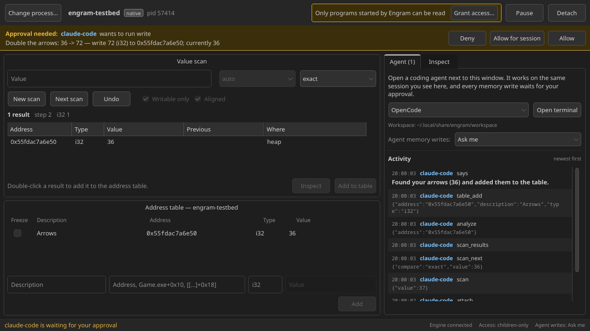

<div align="center">


# Engram

**Сканер памяти и отладчик для Linux, которым можно управлять через ИИ-агента.**

[Установка](#установка) · [Вики](docs/wiki/ru/README.md) · [Справочник инструментов](docs/wiki/en/tools.md) · [English](README.md)

</div>

Engram работает как Cheat Engine или PINCE. Можно найти в запущенной программе число стрел,
золото или здоровье, изменить или заморозить значение, найти код, который его меняет, и
сохранить цепочку указателей, которая переживает перезапуск. Поддерживаются обычные
Linux-программы и Windows-игры под Wine и Proton.

ИИ-агенты для программирования (OpenCode, Claude Code, Codex, Gemini CLI) — полноценные
клиенты. Открой терминал рядом с окном и скажи *«найди, сколько у меня стрел, и удвой»*.
Агент работает в той же сессии, что видишь ты: просит подобрать что-нибудь в игре, сужает скан
и сохраняет адрес в таблицу. Любая запись в память ждёт, пока ты нажмёшь **Allow**.



> Engram предназначен для своих программ и одиночных игр на своём компьютере. Он подключается
> только к процессам твоего пользователя. В онлайн-играх с античитом за такое могут забанить.

## Возможности

- **Сканирование значений**: точное, неизвестное, больше/меньше/между, изменилось/не
  изменилось, увеличилось/уменьшилось (на). Тип `auto` за один проход ищет i32, i64, f32 и f64
  и сортирует находки. Можно искать байты по шаблону с `??` и текст UTF-8/UTF-16. Последний
  шаг скана можно отменить.
- **Таблица адресов**: сохраняется для каждой игры и загружается при подключении. Записи можно
  замораживать и редактировать, адреса задаются выражениями вроде `Game.exe+1A2B30` или
  `[[Game.exe+10]+18]+40`.
- **Анализ**: что лежит по адресу (регион, модуль+смещение, все типы, цель указателя),
  угадывание структур, дизассемблер x86/x64, hex-дамп, запись значения во времени.
- **Поиск указателей**: проверенные цепочки от модулей, которые переживают перезапуск.
- **Поиск кода, который пишет или читает** адрес, через аппаратные точки останова во всех потоках.
- **Wine/Proton**: игры видны как `Game.exe`, образы `.exe`/`.dll` считаются модулями,
  32-битные игры обрабатываются автоматически.
- **Агенты встроены**: MCP-сервер, CLI с компактным JSON, инструкция `AGENTS.md` и кнопка
  «Open terminal». Записи в память требуют твоего подтверждения по выбранной политике.
- **Нативный вид**: окно на Slint берёт стиль Qt и цветовую схему системы.
- **Чистая установка и удаление**: интерактивный установщик, `engram config` для настроек и
  `engram uninstall`, который удаляет ровно то, что было установлено.

## Установка

**Релизный архив** (Rust не нужен): скачай `engram-<версия>-x86_64-linux.tar.gz` из
[Releases](https://github.com/trendorion/engram/releases), распакуй и запусти `./install.sh`.

**Из исходников:** нужны Rust (stable), компилятор C++ и файлы разработки Qt 6
(`qt6-base` в Arch, `qt6-base-dev` в Debian/Ubuntu, `qt6-qtbase-devel` в Fedora).

```sh
git clone https://github.com/trendorion/engram
cd engram
./install.sh
```

Установщик задаст несколько вопросов (куда ставить, нужно ли окно, выдать ли доступ к памяти),
соберёт проект, установит его в `~/.local` и добавит пункт меню. Затем:

```sh
engram setup     # один раз: разрешить Engram читать игры (спросит пароль)
engram doctor    # проверить, что всё в порядке
```

В большинстве дистрибутивов программа может читать память только тех программ, которые сама
запустила. `engram setup` выдаёт одно право (`CAP_SYS_PTRACE`) только маленькому бинарнику
движка. Без этого запускай игры через Engram: поле «Start a program» в окне или параметр
запуска Steam `engram launch -- %command%`. Подробнее — в разделе [Установка](docs/wiki/ru/install.md).

## Быстрый старт

1. Открой **Engram** из меню (`engram-gui`) и нажми **Select process…**.
2. Введи значение из игры и нажми **First scan**.
3. Измени значение в игре, введи новое и нажми **Next scan**. Повторяй, пока не останется
   несколько результатов.
4. Дважды щёлкни результат, чтобы сохранить его. Потом его можно изменить, заморозить
   (**Freeze**) или изучить во вкладке **Inspect**.

С агентом: во вкладке **Agent** нажми **Open terminal** и попроси, что нужно. Настроить вручную:

```sh
claude mcp add engram -- engram mcp         # Claude Code
codex mcp add engram -- engram mcp          # Codex
engram agent-init ~/папка                   # AGENTS.md + opencode.json + .mcp.json
```

Из терминала:

```sh
engram attach name=Game.exe
engram scan value=37
engram scan_next value=36
engram table_add address=0x7f12a0 type=i32 description=Стрелы
```

## Документация

| | |
|---|---|
| [Установка](docs/wiki/ru/install.md) | флаги установщика, доступ к памяти, обновление, удаление |
| [Окно](docs/wiki/ru/window.md) | все панели и кнопки |
| [ИИ-агенты](docs/wiki/ru/agents.md) | настройка MCP, подтверждения и политика |
| [Основы](docs/wiki/ru/concepts.md) | выражения адресов, типы, сканирование, цепочки указателей |
| [Командная строка](docs/wiki/ru/cli.md) и [справочник инструментов](docs/wiki/en/tools.md) | все команды и инструменты |
| [Настройки](docs/wiki/ru/configuration.md) | параметры, файлы, переменные окружения |
| [Проблемы и вопросы](docs/wiki/ru/troubleshooting.md) | права доступа, Wine/Proton, FAQ |
| [Разработка](docs/wiki/ru/development.md) | архитектура, новые инструменты, релизы |

## Как это устроено

```
 engram-gui ─┐
 engram CLI ─┼── Unix-сокет (0600, тот же uid) ──► engramd ──► /proc/<pid>/mem, ptrace
 engram mcp ─┘                                     одна общая сессия
     ▲
     └── OpenCode / Claude Code / Codex / Gemini
```

Сессией владеет `engramd`, а окно, CLI и все агенты — равноправные клиенты. Инструменты,
которые меняют программу-цель, защищены: запрос агента ждёт твоего решения в окне.

## Безопасность

- Engram подключается только к процессам твоего пользователя. Сокет закрыт для других (папка
  0700, сокет 0600), uid собеседника проверяется.
- Пока политика *Ask me* (по умолчанию), агенты не могут без твоего подтверждения менять память,
  замораживать значения, ставить игру на паузу, ставить точки останова и запускать программы.
- `write` принимает ожидаемое значение (`expected`), поэтому запись по устаревшему адресу
  отклоняется, а не портит память.
- Единственная привилегия — `CAP_SYS_PTRACE` у `engramd`, и только если ты выполнил `engram setup`.

Об уязвимостях сообщай приватно, см. [SECURITY.md](SECURITY.md).

## Участие

Issues и pull requests приветствуются. См. [CONTRIBUTING.md](CONTRIBUTING.md) и
[руководство разработчика](docs/wiki/ru/development.md).

## Лицензия

[GPL-3.0-or-later](LICENSE)
