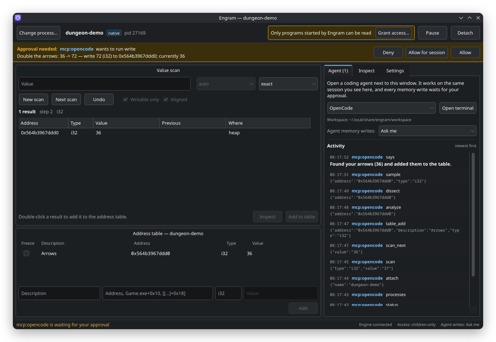
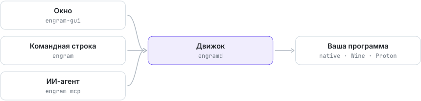

<div align="center">


# Engram

Сканер памяти для Linux, Wine и ИИ-агентов.

[](https://github.com/Trendorin/engram/releases/latest)
[](LICENSE)


[Скачать](https://github.com/Trendorin/engram/releases/latest) · [Установка](#установка) · [Вики](docs/wiki/ru/README.md) · [Изменения](CHANGELOG.md) · [English](README.md)

</div>



Engram работает как Cheat Engine или PINCE. Найдите число стрел, золота или здоровья в
запущенной программе, измените его, заморозьте, найдите код, который его пишет, и сохраните
путь указателей, который переживает перезапуск. Работает с Linux-программами и с играми для
Windows под Wine и Proton.

Им могут управлять и ИИ-агенты для кода (OpenCode, Claude Code, Codex, Gemini CLI). Откройте
терминал рядом с окном и попросите *«найди, сколько у меня стрел, и удвой»*: агент работает в той
же сессии, что вы видите, просит изменить значение в игре, сужает поиск и сохраняет адрес в
таблицу. Изменить память он не может, пока вы не нажмёте **Allow**.

## Возможности

- Поиск значений: точный, неизвестный, больше, меньше, между, изменилось, не изменилось,
  выросло, упало. `auto` за один проход проверяет i32, i64, f32 и f64 и ранжирует находки.
- Байтовые шаблоны с `??`, текст UTF-8 и UTF-16, один шаг отмены.
- Таблица адресов для каждой игры, заморозка и выражения вида `Game.exe+1A2B30` или
  `[[Game.exe+10]+18]+40`.
- Поиск указателей: проверенные пути от модулей.
- Аппаратные точки останова: кто пишет или читает адрес.
- Игры под Wine и Proton видны как `Game.exe`, PE-модули и 32-битные игры поддерживаются.
- MCP-сервер и командная строка для агентов; любое изменение программы ждёт вашего решения.
- Родное окно (Slint в вашем стиле Qt), светлое и тёмное.

## Установка

| ваша система | файл из [последнего релиза](https://github.com/Trendorin/engram/releases/latest) |
|---|---|
| Arch Linux, CachyOS, Manjaro | `engram-1.1.1-1-x86_64.pkg.tar.zst` |
| Debian 13 и новее | `engram_1.1.1-1_amd64.deb` |
| Fedora 44 и новее | `engram-1.1.1-1.fc44.x86_64.rpm` |
| любой дистрибутив с glibc 2.35+ | `Engram-1.1.1-x86_64.AppImage` |

```sh
sudo pacman -U ./engram-1.1.1-1-x86_64.pkg.tar.zst    # Arch
sudo apt install ./engram_1.1.1-1_amd64.deb            # Debian
sudo dnf install ./engram-1.1.1-1.fc44.x86_64.rpm      # Fedora
chmod +x Engram-1.1.1-x86_64.AppImage && ./Engram-1.1.1-x86_64.AppImage
```

Каждый пакет собирается в чистом контейнере своего дистрибутива, затем ставится и запускается
там до публикации. Проверить файлы: `sha256sum --ignore-missing -c SHA256SUMS`.
С аргументами AppImage работает как командная строка `engram` (`./Engram-*.AppImage doctor`).

### Из исходников

Нужны Rust 1.88+, компилятор C++ и заголовки Qt 6 (`qt6-base` в Arch, `qt6-base-dev` в Debian,
`qt6-qtbase-devel` в Fedora).

```sh
git clone https://github.com/Trendorin/engram && cd engram
./install.sh                 # задаст пару вопросов, соберёт и поставит в ~/.local
./install.sh --uninstall     # удалит ровно то, что поставил
```

`./install.sh --help` покажет параметры (`--yes`, `--prefix`, `--no-gui`, `--setup`).

### Доступ к памяти

Большинство дистрибутивов позволяет читать память только тех программ, которые вы запустили
сами (Yama `ptrace_scope=1`). Либо запускайте игры через Engram (**Start a program** в окне или
`engram launch -- %command%` в параметрах запуска Steam), либо один раз выполните:

```sh
engram setup     # даёт CAP_SYS_PTRACE только engramd; спросит пароль
engram doctor    # проверит всё
```

AppImage доступен только для чтения, поэтому с ним работает лишь первый способ.

## Начало работы

1. Откройте **Engram** из меню и нажмите **Select process…**.
2. Введите значение из игры и нажмите **First scan**.
3. Измените значение в игре, введите новое и нажмите **Next scan**. Повторите.
4. Двойной щелчок по результату сохраняет его. Дальше его можно править, поставить **Freeze**
   или открыть **Inspect**.

То же из терминала:

```sh
engram attach name=Game.exe
engram scan value=37
engram scan_next value=36
engram table_add address=0x7f12a0 type=i32 description=Arrows
```

## ИИ-агенты

Во вкладке **Agent** нажмите **Open terminal** и попросите, что нужно. Настройка вручную:

```sh
claude mcp add engram -- engram mcp         # Claude Code
codex mcp add engram -- engram mcp          # Codex
engram agent-init ~/some-folder             # AGENTS.md, opencode.json и .mcp.json
```

Всё, что меняет программу (запись, заморозка, пауза, точки останова, запуск программ), ждёт
вашего решения в окне, пока политика — **Ask me** (по умолчанию). `write` получает значение,
которое агент ожидает увидеть, поэтому устаревший адрес отклоняется, а не портит память.
Подробнее — [ИИ-агенты](docs/wiki/ru/agents.md).

## Как устроено

<picture><source media="(prefers-color-scheme: dark)" srcset=".github/assets/flow-ru-dark.svg"></picture>

Сессией владеет `engramd`. Окно, командная строка и каждый агент — равные клиенты через
закрытый Unix-сокет (каталог 0700, сокет 0600, проверка uid собеседника).

## Безопасность

- Engram подключается только к обычным процессам вашего пользователя, по правилам ptrace самого
  ядра и без обхода, который дала бы capability: все uid и gid цели ваши, у неё нет capability
  сверх тех, что у движка, и она dumpable. Программы с setuid и file capabilities (`sudo`,
  `passwd`) и процессы, защищающие свою память (`ssh-agent`, `gpg-agent`), отклоняются.
- Память читается через дескриптор `/proc/<pid>/mem`, открытый при подключении. Если цель
  запустит другую программу, доступ заканчивается, а не переходит к ней.
- `CAP_SYS_PTRACE` появляется только после `engram setup`, только у `engramd` и действует только
  в момент подключения.
- Подтверждение защищает от ошибок агента. Это не песочница против программ, которые уже
  работают от вашего имени.

Engram — для своих программ и одиночных игр. В онлайн-играх с античитом за него могут забанить.
Об уязвимостях сообщайте приватно, см. [SECURITY.md](SECURITY.md).

## Документация

| | |
|---|---|
| [Установка](docs/wiki/ru/install.md) | пакеты, параметры установщика, доступ к памяти, обновление, удаление |
| [Окно](docs/wiki/ru/window.md) | все панели и кнопки |
| [ИИ-агенты](docs/wiki/ru/agents.md) | MCP, подтверждения и политика |
| [Понятия](docs/wiki/ru/concepts.md) | выражения адресов, типы, поиск, указатели |
| [Командная строка](docs/wiki/ru/cli.md) · [Инструменты](docs/wiki/en/tools.md) | все команды и инструменты |
| [Настройки](docs/wiki/ru/configuration.md) · [Решение проблем](docs/wiki/ru/troubleshooting.md) | параметры, файлы, частые проблемы |
| [Разработка](docs/wiki/ru/development.md) | архитектура, новые инструменты, релизы |

[Участие](CONTRIBUTING.md) · [Безопасность](SECURITY.md) · [Изменения](CHANGELOG.md)

<div align="center"><sub>GPL-3.0-or-later · <a href="https://github.com/Trendorin">Trendorin</a></sub></div>
